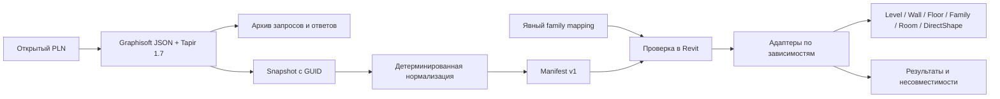

# Архитектура и границы переноса

## Анализ baseline

1. `stories[].level` — абсолютная отметка, `stories[].index` — индекс этажа. Ключом должен быть index; округление `zCoordinate-bottomOffset` и поиск ближайшей отметки способны дать неверный этаж.
2. `GetDetailsOfElements.id` — марка/информационная строка. GUID находится в `GetElementsByType/GetAllElements.elements[].elementId.guid`. Ответы деталей позиционные; ошибки должны оставаться на своих местах до сопоставления GUID.
3. Имя типа не идентифицирует его конструкцию. Одноимённый WallType может иметь другую толщину, порядок слоёв или материалы. Нужны стабильный источник и хеш конструкции.
4. В исходном макросе не передаются Building Materials, границы core/shell и опорная линия стены. Даже при совпадении координат `Line` физические поверхности могут сместиться.
5. `Finish → Finish1` для всех отделок недостаточно: внешний и внутренний shell разделяются относительно core. В Revit порядок слоёв стены — exterior→interior, перекрытия — top→bottom. Порядок не сортируется по толщине или типу слоя.
6. `max(width, 0.0105 ft)` меняет толщину здания. Нулевые отделочные слои можно представить мембраной. Положительные недопустимые слои требуют явной политики и отчёта о потере; автоматически она не применяется.
7. Одна Transaction для всей модели делает ошибку одной двери ошибкой всего импорта. Нужны отдельные commit и индекс только успешно созданных хостов.
8. Нет повторного сопоставления GUID, отчёта несовместимостей, версии контракта и системы координат. Их нужно ввести до дальнейшего расширения.

## Слои системы

AI может помогать разбирать диагностические сообщения, предлагать сопоставление свойств и семейств, генерировать адаптеры и тестовые сценарии. Предложение AI проходит проверку и превращается в сохранённую конфигурацию. Никакие координаты, полигоны или трансформации не выводятся из естественного языка модели.

## Контракт

Единицы: длина — метры, угол геометрии — радианы. Значения свойств сохраняются вместе с их API-типами/status и определениями. Не следует считать, что любое числовое свойство — длина. IFC и GDL имеют собственные типы; исходные структуры не приводятся все к строкам.

`coordinates.transform` — один поворот вокруг Z и перенос в метрах. Это явное project-to-Revit преобразование. Геолокация и Survey Point архивируются, но автоматически не изменяют Shared Coordinates, ProjectLocation, True North или Base Point Revit. Для них нужен отдельный согласованный режим.

У элемента есть sourceGuid, mark, home levelKey, status, dependencies, payload, raw и contentHash. Марка не участвует в идентичности. GUID классификации, атрибуты слоя и GDL сохраняются внутри raw; общие определения лежат в snapshot/manifest.

`ready` — поддержанная нормализация. `needsMapping` — потребуется эквивалентное семейство. `unsupported` — геометрический адаптер отсутствует или входные данные неоднозначны. Импортёр выдаёт created/unchanged/conflict/blocked/failed/rolledBack, а не объявляет всю модель успешной из-за окончания цикла.

## Порядок построения

1. Валидация версии, единиц, UUID, уникальности ключей, ссылок, циклов и чисел.
2. Этажи; материалы; конструкции стен/перекрытий.
3. Колонны, стены, балки, перекрытия и другие независимые тела.
4. Двери, окна, проёмы — после их конкретных хостов.
5. Room или Space после всех ограждений. Положение штампа зоны не используется как точка размещения: штамп может находиться вне помещения.
6. В дальнейшем — MEP, соединения, системы, shared parameters, проверки и документация.

Алгоритм делает топологический обход dependencies, а порядок категорий задаёт устойчивую очередность независимых элементов. GUIDы внутри этапа сортируются.

## Что нужно добавить для универсального транслятора

### Геометрия после операций Archicad

Параметрические детали стены или перекрытия не описывают автоматически её итоговый BRep после SEO, trimming, complex profile, вырезов и всех сопряжений. Нельзя назвать параметрический импорт гарантированно точной копией таких элементов. Для реальной проверки нужны исходная результирующая геометрия и сравнение.

Добавить собственную read-only команду C++ аддона, например `Ac2Revit.GetEvaluatedBodies`, с явным протоколом версии. Это **предлагаемая новая команда**, не существующая команда Tapir 1.7. Вызов остаётся через `API.ExecuteAddOnCommand`, но namespace должен принадлежать нашему аддону. На выходе: GUID и instance path, локальный transform, connected solids, face loops/holes, исходные материалы, точность тесселяции и ошибки по элементам. Все единицы и система координат задаются явно.

Для кривых поверхностей сохранять analytic BRep при поддержке целевого API или тесселяцию с заявленным chord tolerance; тесселяция не является математически точной кривой поверхностью. Не использовать BoundingBox как замену геометрии. Не считать floorPlanPolygons объёмной геометрией: это результат 2D-отображения/сечения.

Morph уже предоставляет локальные вершины/грани в Tapir 1.7 и имеет реализованный DirectShape-адаптер. Его transform хранит строки матрицы под именами xAxis/yAxis/zAxis — это проверено по upstream-коду и покрыто тестом.

### Native-first и контролируемый fallback

- Обычные стены/перекрытия/проёмы/помещения создаются нативно.
- Колонны/балки/GDL объекты сопоставляются с проверенным семейством. Сходство габаритов не доказывает равенства формы; калибровка должна включать profile/GDL геометрию и зеркальность.
- Профильные/сложные стены, лестницы, ограждения, крыши и произвольные тела сначала требуют специализированного адаптера. Геометрический DirectShape допустим как отдельно помеченный fallback после появления полного исходного тела. Он не даёт нативную редактируемость лестницы, стены или MEP-системы.
- IFC может быть дополнительным транспортом геометрии/классификаций. IFC-файл сам по себе не обеспечивает идентичные нативные семейства и не заменяет проверку семантики.

### Инкрементальное обновление

Текущая реализация вставляет и предотвращает повторное создание. Изменившийся источник создаёт conflict. Следующий этап: отдельные Update-адаптеры для каждого класса; валидация локальных изменений Revit; host-aware перестроение; журнал последнего согласованного состояния. Не пересоздавать стену без анализа размещённых окон, дверей, размеров, тегов и пользовательских зависимостей.

Удаление должно опираться на полный scope экспорта и отдельный согласованный режим. Отсутствие элемента в частичной выгрузке не означает, что его следует удалить из RVT.

### Полнота данных и документация

Добавить статусы renovation/phase, design options, SEO/trim relations, hotlink-instance path и трансформации, составные/сегментированные элементы, MEP-коннекторы и системы. Название/тип GDL не описывает весь evaluated solid. Поля, которые Tapir не раскрывает, следует извлекать через C++ SDK; нельзя заполнять их предположениями.

Свойства в Extensible Storage сохраняют данные, но не становятся колонками спецификации. Для shared parameters нужна таблица source property GUID→target parameter GUID, SpecTypeId, единицы, instance/type binding, категории и политика конфликтов. Material appearance/thermal assets, поверхности, текстуры и приоритеты соединения требуют отдельных адаптеров.

Виды, листы, аннотации и графическое оформление — отдельная подсистема. Их перенос зависит от целевого шаблона и не следует смешивать с созданием геометрии.

## Критерии приёмки

Сначала небольшой проверочный RVT: два этажа, асимметричная многослойная стена с разными опорными линиями и flip; дуговая стена; перекрытие с отверстием; дверь и окно; вогнутая зона с отверстием; колонна/балка/объект; Morph с поворотом.

Проверять home story, Z/offset, кривую и поверхности, порядок/толщину слоёв, core, host GUID, opening width/height/sill/hand/facing, polygon loops, room containment и площадь, объём/границы Morph. Тест повторного запуска не должен увеличивать число элементов. Изменение источника должно давать явный conflict до реализации update.

Сборка DLL и десериализация — обязательные, но недостаточные проверки: запуск в Revit, подтверждение семейств и сравнение результата на реальной модели ещё нужны.

Источники: [Tapir ElementCommands v1.7](https://github.com/ENZYME-APD/tapir-archicad-automation/blob/1.7.0/archicad-addon/Sources/ElementCommands.cpp), [Tapir CommandBase](https://github.com/ENZYME-APD/tapir-archicad-automation/blob/1.7.0/archicad-addon/Sources/CommandBase.cpp), [Tapir Morph](https://github.com/ENZYME-APD/tapir-archicad-automation/blob/1.7.0/archicad-addon/Sources/ExtendedElementCommands.cpp), [Graphisoft API](https://archicadapi.graphisoft.com/archicadPythonPackage/archicad.html), [CompoundStructure](https://help.autodesk.com/cloudhelp/2026/ENU/Revit-API/files/Revit_API_Developers_Guide/Revit_Geometric_Elements/Walls_Floors_Ceilings_Roofs_and_Openings/Revit_API_Revit_API_Developers_Guide_Revit_Geometric_Elements_Walls_Floors_Ceilings_Roofs_and_Openings_CompoundStructure_html.html).
